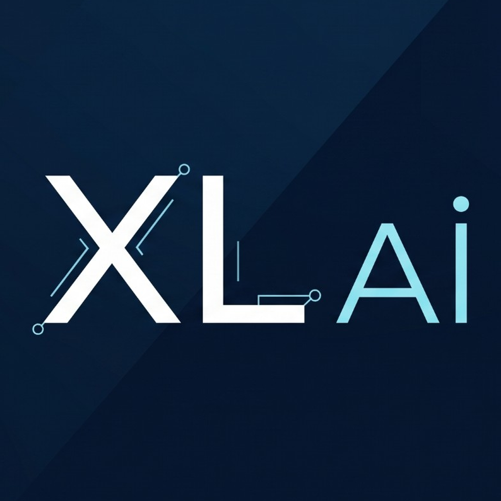

# XL AI Stüdyo

<p align="center">
  
</p>

<p align="center">
  <strong>Bilgisayarınızda, internetsiz ve ücretsiz çalışan açık kaynak yapay zeka stüdyosu.<br/>
  Görsel, pixel art, 3D, ses ve yapay zeka sohbeti tek uygulamada.</strong>
</p>

<p align="center">
  
  
  
</p>

XL AI Stüdyo, [DD:YZ Sansürsüz Lokal AI Stüdyosu](https://github.com/DDYapayZeka/SansursuzLokalAIStudyosu-DDYZ) üzerine kurulu bir projedir. Oyun geliştiriciler, mod yapımcıları, tasarımcılar ve pixel art üreticileri için yeni modüller ekler. DD:YZ'nin bütün özellikleri aynen çalışmaya devam eder.

- **Tamamen yerel:** Her şey kendi bilgisayarınızda çalışır. Hesap, API anahtarı veya abonelik gerekmez.
- **İnternetsiz:** Modelleri bir kez indirdikten sonra internet bağlantısı gerekmez. Telemetri yoktur.
- **Taşınabilir:** Bilgisayara hiçbir şey kurmaz; USB SSD'den çalışabilir.
- **Açık kaynak:** Kod MIT lisanslıdır. Her modelin lisansı uygulamada açıkça gösterilir.

> **Proje şu an erken geliştirme aşamasında.** Bugün indirdiğinizde DD:YZ'nin tüm özellikleri çalışır. XL AI Stüdyo'nun yeni özellikleri aşağıdaki yol haritasına göre sırayla eklenecek.

---

## İçindekiler

1. [Neler yapabilir?](#neler-yapabilir)
2. [Sistem gereksinimleri](#sistem-gereksinimleri)
3. [Kurulum (adım adım)](#kurulum-adim-adim)
4. [İlk kullanım](#ilk-kullanim)
5. [USB veya harici diskte kullanım](#usb-veya-harici-diskte-kullanim)
6. [Sürümler: Hafif, Stüdyo, Tam](#surumler-hafif-studyo-tam)
7. [Sorun giderme](#sorun-giderme)
8. [Geliştiriciler için](#gelistiriciler-icin)
9. [Lisans, etik ve teşekkür](#lisans-etik-ve-tesekkur)

---

## <a id="neler-yapabilir"></a>Neler yapabilir?

| Özellik | Durum |
| --- | --- |
| Metinden görsel (Stable Diffusion 1.5, SDXL) | ✅ Çalışıyor |
| Yapay zeka sohbeti (GGUF modeller: Qwen, Llama, Gemma, Mistral…) | ✅ Çalışıyor |
| Sesten metne (Whisper) | ✅ Çalışıyor |
| Metinden sese (Kokoro) | ✅ Çalışıyor |
| Donanım algılama (NVIDIA, AMD, Intel, Apple Silicon) | ✅ Çalışıyor |
| "XL Studyo" sekmesi, iş kuyruğu, model lisans kaydı | 🛠️ Geliştiriliyor (F1) |
| Ekran kartına göre otomatik ayar ve VRAM yönetimi | 🔜 Planlandı (F2) |
| Pixel art üretimi, LoRA desteği ve kendi LoRA'nızı eğitme | 🔜 Planlandı (F3) |
| Dünya haritası, arazi ve tileset üretimi | 🔜 Planlandı (F3) |
| Görselden ve metinden 3D model (GLB, FBX, OBJ, USDZ, STL) | 🔜 Planlandı (F4) |
| Türkçe güçlü TTS, ses tasarımı, ses dönüştürme (RVC), ses efektleri | 🔜 Planlandı (F5) |
| Uzak GPU, eklenti deposu, Legacy Mod Atölyesi | 🔜 Planlandı (F6) |
| Blender, Godot, Unity, Unreal, Maya eklentileri | 🔜 Planlandı (F7) |

Ayrıntılı plan: [docs/tasarim.md](docs/tasarim.md)

---

## <a id="sistem-gereksinimleri"></a>Sistem gereksinimleri

| | En az | Önerilen |
| --- | --- | --- |
| İşletim sistemi | Windows 10/11, Linux (glibc 2.38+, ör. Ubuntu 24.04), macOS (Apple Silicon) | Aynı |
| Ekran kartı | Gerekmez (yalnızca işlemciyle çalışır, ama yavaştır) | NVIDIA RTX, 6 GB+ VRAM |
| RAM | 8 GB | 16 GB+ |
| Disk | 15 GB boş alan | 64 GB+ SSD |
| Tarayıcı | Chrome, Edge, Firefox veya Brave | Aynı |

Bir ipucu: modeller büyük dosyalardır (2–8 GB). Normal bir harddisk (HDD) yerine SSD kullanmak, modellerin açılmasını dakikalardan saniyelere indirir.

---

## <a id="kurulum-adim-adim"></a>Kurulum (adım adım)

İlk açılışta gereken her şey (Node.js, görsel ve sohbet motorları) otomatik olarak uygulama klasörüne indirilir. Bunun için ilk açılışta internet gerekir.

### Windows

1. Bu sayfanın üstündeki yeşil **Code** düğmesine basın, ardından **Download ZIP** seçeneğine tıklayın.
2. İndirilen ZIP dosyasını **kısa ve boşluksuz bir klasöre** çıkarın. Örnek: `C:\XLAI`.
3. Klasördeki **`windows.bat`** dosyasına çift tıklayın.
4. Windows "bilinmeyen yayıncı" uyarısı verirse **Ek bilgi**, sonra **Yine de çalıştır**'a basın.
5. İlk kurulum internet hızınıza göre birkaç dakika sürer. Bittiğinde tarayıcınızda `http://localhost:1420` kendiliğinden açılır.

### Linux

```bash
git clone https://github.com/BlockDogXL/XL-AI-Studyo.git
cd XL-AI-Studyo
chmod +x linux.sh scripts/setup/*.sh
./linux.sh
```

- **AMD ekran kartı:** ROCm desteği için `./linux.sh --max-perf`
- **Intel Core Ultra NPU:** `./linux.sh --setup-openvino`
- **"İzin reddedildi" hatası** (özellikle USB'de): `bash linux.sh` ile başlatın.

### macOS (Apple Silicon)

```bash
git clone https://github.com/BlockDogXL/XL-AI-Studyo.git
cd XL-AI-Studyo
chmod +x mac.sh
./mac.sh
```

Ardından tarayıcıda `http://localhost:1420` adresini açın.

---

## <a id="ilk-kullanim"></a>İlk kullanım

1. Sol menüden **Model Yoneticisi**'ni açın.
2. **Uyumlu Modelleri Indir** düğmesine basın. Stüdyo ekran kartınızı ve belleğinizi okur, her alan (görsel, sohbet, konuşma) için bilgisayarınıza uygun bir model seçip indirir. İsterseniz listeden modelleri tek tek de indirebilirsiniz.
3. Görsel üretmek için **Gorsel Uretici** sekmesinde bir model seçip yükleyin, sonra bir açıklama (prompt) yazın.
4. Sohbet için **Metin Sohbeti** sekmesinde bir model seçin. Konuşmayı yazıya çevirmek için **Konusma Yazici**, metni seslendirmek için **Metinden Sese** sekmelerini kullanın.

**Ekran kartınıza göre model önerisi:**

| Ekran kartı belleği | Görsel | Sohbet |
| --- | --- | --- |
| Yok / 4 GB | SD 1.5 | 1–4B model, Q4 (ör. Qwen3-4B) |
| 6–8 GB | SD 1.5, SDXL | 4–8B model, Q4 |
| 12 GB+ | SDXL | 8–14B model, Q4 |

Ekran kartı belleğinizi öğrenmek için (Windows): **Görev Yöneticisi → Performans → GPU → Ayrılmış GPU belleği**.

---

## <a id="usb-veya-harici-diskte-kullanim"></a>USB veya harici diskte kullanım

Stüdyo bütün dosyalarını kendi klasöründe tutar, yani bir USB SSD'ye kopyalayıp başka bilgisayarlarda da çalıştırabilirsiniz.

- **FAT32 kullanmayın:** 4 GB'tan büyük dosyaları desteklemez, modeller yarım iner.
- **Format önerisi:** yalnızca Windows için **NTFS**; Windows ve Linux birlikte için **exFAT**; yalnızca Linux için **ext4**.
- **Donanım önerisi:** USB flash bellek yerine **USB 3.2 Gen 2 (10 Gbps) taşınabilir SSD** veya bir NVMe SSD + harici kutu. Flash bellekler hem çok yavaştır hem de çabuk yıpranır.
- Diski çıkarmadan önce her zaman **"Donanımı güvenle kaldır"** kullanın.

---

## <a id="surumler-hafif-studyo-tam"></a>Sürümler: Hafif, Stüdyo, Tam

Yeni özellikler tamamlandığında stüdyo üç hazır paket halinde de sunulacak. Üçü de aynı programdır; tek fark birlikte gelen modellerdir. Daha büyük pakete geçerken yalnızca eksik modeller indirilir.

| | Hafif | Stüdyo | Tam |
| --- | --- | --- | --- |
| Disk | ~22 GB | ~90 GB | ~200 GB |
| Ekran kartı | İşlemci veya 6–8 GB | 12–16 GB | 24 GB+ |
| Öne çıkanlar | Görsel, 2D pixel art, sohbet, Türkçe TTS, ses dönüştürme | + FLUX, 3D model, ses tasarımı, ses efektleri | + Qwen-Image, TRELLIS.2, büyük sohbet modelleri, gelişmiş eğitim |

Bugünkü sürüm (DD:YZ'nin özellikleri) varsayılan modellerle yaklaşık **10–11 GB** tutar.

---

## <a id="sorun-giderme"></a>Sorun giderme

| Sorun | Çözüm |
| --- | --- |
| Bir şey yarım indi veya bozuldu | `scripts/reset/reset.ps1` (Windows) veya `scripts/reset/reset.sh` (Linux/macOS) çalıştırın. Modelleriniz ve çıktılarınız **silinmez**. |
| Windows `0xC0000135` hatası | Ekran kartı sürücünüzü güncelleyin (NVIDIA Game Ready / AMD Adrenalin). |
| Linux `GLIBC_2.38 not found` | Hazır motorlar yeni bir Linux sürümü ister (Ubuntu 24.04, Fedora 40+, Mint 22). Sisteminizi güncelleyin veya motorları kaynaktan derleyin. |
| Tarayıcı açılmadı | Elle `http://localhost:1420` adresine gidin. Port doluysa program bir sonraki boş portu kullanır; komut penceresinde yazan adrese bakın. |
| Dizüstünde dahili ekran kartı kullanılıyor (Linux) | `SD_VULKAN_DEVICE=vulkan1 ./linux.sh` ile başlatın. |
| Görsel üretimi çok yavaş | Ekran kartınıza uygun daha küçük bir model seçin (yukarıdaki tablo) ve tarayıcıda gereksiz sekmeleri kapatın. |
| Model 4 GB'ta takılıp kaldı | Disk FAT32 olabilir; NTFS veya exFAT'a biçimlendirin. |

Sorununuz listede yoksa bir [Issue](https://github.com/BlockDogXL/XL-AI-Studyo/issues) açın. İşletim sisteminizi, ekran kartınızı ve hata mesajını yazın.

---

## <a id="gelistiriciler-icin"></a>Geliştiriciler için

**Ana kural:** DD:YZ'nin koduna olabildiğince dokunulmaz. Yeni kod `ext/` (sunucu) ve `app/frontend/src/ext/` (arayüz) altında yaşar. DD:YZ dosyalarındaki her değişiklik birkaç satırı geçmez ve `DDYZ-FORK` yorumuyla işaretlenir. Böylece DD:YZ'nin yeni sürümleri sorunsuz birleştirilebilir.

```bash
# Orijinal DD:YZ'yi upstream olarak bağlama (bir kez)
git remote add upstream https://github.com/DDYapayZeka/SansursuzLokalAIStudyosu-DDYZ.git

# DD:YZ güncellemesini alma
git fetch upstream
git merge upstream/main

# Testler
(cd app/frontend && npm ci)
node --test scripts/tests/issue-regressions.test.cjs
```

| Klasör | İçerik |
| --- | --- |
| `app/` | DD:YZ arayüzü, motorlar, modeller ve çıktılar |
| `scripts/` | DD:YZ sunucusu (`server/serve.cjs`), kurulum betikleri, testler |
| `ext/` | XL AI Stüdyo sunucu modülleri (geliştiriliyor) |
| `docs/tasarim.md` | Tasarım dokümanı: mimari, modüller, lisanslar, yol haritası |
| `docs/superpowers/plans/` | Fazların adım adım uygulama planları |
| `docs/DDYZ-README.md` | DD:YZ'nin orijinal README'si |

Katkı yapmak isterseniz önce [tasarım dokümanını](docs/tasarim.md) okuyun, ardından bir Issue açarak ne üzerinde çalışmak istediğinizi yazın.

---

## <a id="lisans-etik-ve-tesekkur"></a>Lisans, etik ve teşekkür

**Lisans:** Kod [MIT Lisansı](LICENSE) ile lisanslıdır. İndirdiğiniz her yapay zeka modeli kendi lisansına tabidir. Bazı modeller ticari kullanıma kapalıdır; stüdyo bunları ilgili ekranlarda ayrıca işaretleyecek. Ticari bir projede kullanmadan önce modelin lisansını kontrol edin.

**Etik kurallar:**
- Gerçek bir kişinin sesi, izni olmadan kopyalanmaz. Ses modülleri yalnızca izinli veya telifsiz sesler kullanır ve yapay sesler üretir.
- Gerçek kişilerin rızası olmadan sahte görsel veya ses üretmek için kullanılmaz.
- Legacy Mod Atölyesi yalnızca lisansı izin veren veya yazarından izin alınmış modlarla çalışır. Kopya koruması ve DRM atlatma desteklenmez.

**Teşekkür:**
- [DD:YZ (Derine Dalıyoruz: Yapay Zeka)](https://github.com/DDYapayZeka/SansursuzLokalAIStudyosu-DDYZ): bu projenin temeli. [YouTube kanalı](https://www.youtube.com/@derinedaliyoruzyapayzeka)
- [techjarves / Uncensored-Local-Studio](https://github.com/techjarves/Uncensored-Local-Studio): DD:YZ'nin temel aldığı özgün proje.
- [stable-diffusion.cpp](https://github.com/leejet/stable-diffusion.cpp), [llama.cpp](https://github.com/ggml-org/llama.cpp), [whisper.cpp](https://github.com/ggml-org/whisper.cpp) ve [Kokoro](https://huggingface.co/hexgrad/Kokoro-82M) geliştiricileri.
