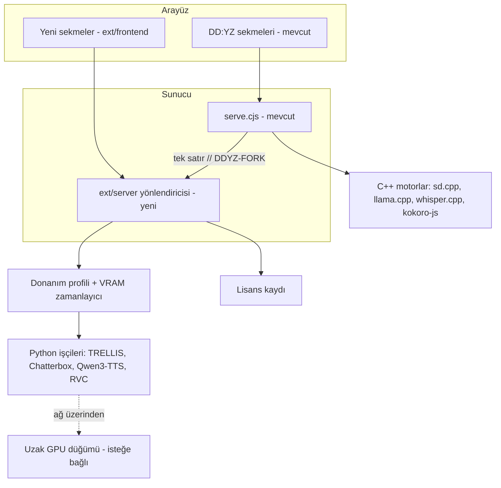
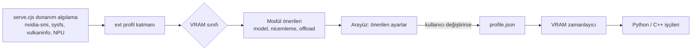
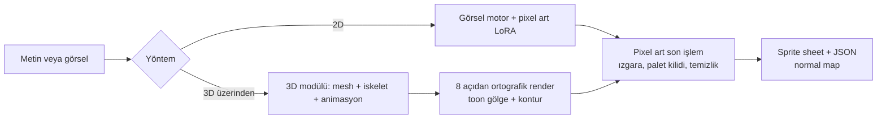
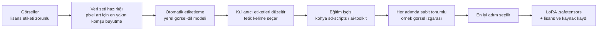
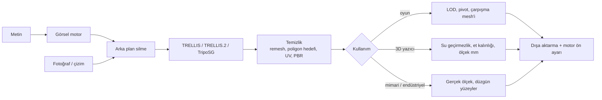
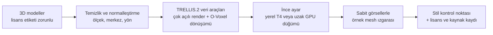
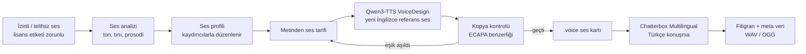
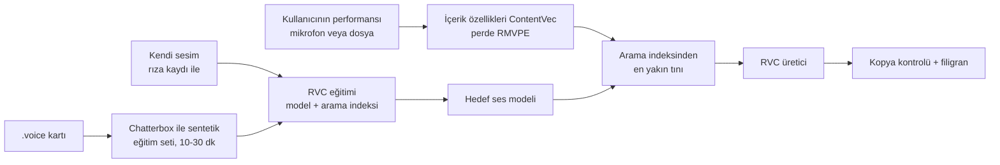
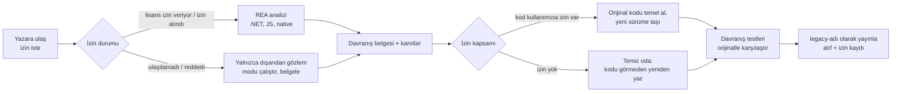

# XL AI Stüdyo — Tasarım Dokümanı

Başlangıç: 2026-10-14 · Canlı sürüm: [Claude Docs](https://claude.ai/code/artifact/35757b07-90e4-47fd-a553-0388f5bd2583) (bu dosya onun kopyasıdır)

DD:YZ'nin ana koduna dokunmadan eklentilerle genişleyen, görsel, pixel art, harita, 3D mesh ve ses üreten, ekran kartına göre kendini ayarlayan, tamamen açık kaynak ve çevrimdışı öncelikli bir lokal AI stüdyosu. DD:YZ'nin kaynak kodu incelendi; aşağıdaki kararlar bu incelemeye dayanır.

## Temel ilkeler

Yeni her şey DD:YZ'nin yanına eklenir, içine yazılmaz; orijinal özellikler aynı şekilde çalışmaya devam eder.

**DD:YZ'nin bugünkü yapısı (kod incelendi, 2026-10-14):**

| Katman | Bugün | Dosya / klasör |
| --- | --- | --- |
| Arayüz | React 19 + Vite, Tauri 2 hazırlığı | `app/frontend/src/` (App.jsx, components/) |
| Sunucu | Tek Node.js HTTP sunucusu, `if (req.url === ...)` zinciriyle \~60 uç nokta | `scripts/server/serve.cjs` (\~7.400 satır) |
| Motorlar | stable-diffusion.cpp, llama.cpp, whisper.cpp, kokoro-js | `app/backend/`, `app/llm-backend/`, `scripts/workers/` |
| Python | Yalnızca yardımcı işçiler (OpenVINO NPU, CoreML) | `scripts/workers/*.py` |
| Donanım | NVIDIA, AMD ROCm/Vulkan, Intel NPU, Apple Metal algılama zaten var | `serve.cjs` içinde |
| Lisans | MIT, techjarves'ın Uncensored-Local-Studio projesinden türetilmiş | `LICENSE` |

**İlkeler:**

1. **Ana koddan çıkmama.** Yeni kod `ext/` klasöründe yaşar. Orijinal dosyalara yalnızca birkaç satırlık bağlantı eklenir ve her biri `// DDYZ-FORK` ile işaretlenir.
2. **Upstream ile senkron.** Orijinal repo `upstream` olarak bağlanır, yeni sürümler düzenli birleştirilir. Orijinal testler (`scripts/tests/`) her birleştirmede geçmelidir.
3. **Taşınabilirlik korunur.** DD:YZ USB'den çalışabiliyor. Yeni Python motorları da global kurulum yapmadan, uygulama klasörü içindeki taşınabilir bir Python ile gelir.
4. **Çevrimdışı öncelik.** Modeller indirildikten sonra her özellik internetsiz çalışır. Telemetri yoktur.
5. **Lisans görünürlüğü.** Her model ve araç bir lisans etiketi taşır. "Yalnızca ticari kullanıma uygun" filtresi tek tıkla açılır.
6. **Ses etiği.** Gerçek bir kişinin sesi kopyalanmaz. Yalnızca izinli veya telifsiz veriden yeni sentetik sesler üretilir ve her çıktı bir kopya kontrolünden geçer.
7. **Legacy eklentiler.** Geliştirmesi durmuş eklentiler `legacy-<ad>` adıyla, lisansı izin veriyorsa atıfla, vermiyorsa yazar izniyle veya temiz oda yöntemiyle yeniden yazılarak alınır.

## Genel mimari



Orijinal sunucu `serve.cjs`, bilmediği her `/api/ext/*` isteğini tek bir işaretli satırla yeni yönlendiriciye devreder; yeni işler ayrı Python süreçlerinde çalışır ve VRAM zamanlayıcı bunları mevcut motorlarla çakışmayacak şekilde sıraya koyar.

## Teknoloji yığını

DD:YZ'nin Node.js + React + C++ motor yapısı korunur; 3D ve yeni ses modelleri Python'da olduğu için bunlar ayrı işletilen Python işçileri olarak eklenir.

| Katman | Seçim | Lisans | Gerekçe |
| --- | --- | --- | --- |
| Arayüz | React 19 + Vite (mevcut), yeni sekmeler `ext/frontend/` içinde | MIT | DD:YZ zaten bunu kullanıyor; aynı bileşen ve tema yapısı sürdürülür |
| Masaüstü kabuğu | Tarayıcı (mevcut, port 1420); isteğe bağlı Tauri 2 | MIT / Apache-2.0 | package.json'da Tauri 2 hazır; zorunlu değil |
| Orkestratör | Node.js `serve.cjs` (mevcut) + `ext/server/` yönlendiricisi | MIT | Tek bağlantı satırıyla yeni API'ler eklenir, ana dosya küçük kalır |
| Python çalışma ortamı | python-build-standalone + `uv`, uygulama klasöründe | MPL-2.0 / MIT-Apache | Taşınabilir, global kurulum yok; DD:YZ'nin USB ilkesine uyar |
| Python işçileri | FastAPI + Uvicorn, her modül ayrı süreç | MIT / BSD-3 | Bir modül çökerse stüdyo çökmez; VRAM süreci kapatınca boşalır |
| Derin öğrenme | PyTorch (CUDA / ROCm / MPS / CPU) | BSD-3 | TRELLIS, Chatterbox, Qwen3-TTS bunu gerektiriyor |
| Görsel motor | stable-diffusion.cpp (mevcut), genişletilmiş model desteğiyle | MIT | Zaten entegre; FLUX ve LoRA desteği sd.cpp tarafında mevcut, DD:YZ entegrasyonu eksik |
| 3D işleme | trimesh, xatlas, manifold3d, Open3D | MIT / MIT / Apache-2.0 / MIT | Mesh temizliği, UV açma, 3D yazıcı için su geçirmezlik |
| Dışa aktarma | Blender (arka planda, ayrı süreç) + usd-core | GPL-3.0 (ayrı süreç) / TOST (Apache tabanlı) | FBX için tek tam açık kaynak yol; ayrı süreç olduğu için GPL koda bulaşmaz |
| Ses analizi | librosa, torchcrepe, SpeechBrain ECAPA | ISC / MIT / Apache-2.0 | Ton, tını ve konuşmacı benzerliği ölçümü |
| İş kuyruğu | Node içinde basit kuyruk + SQLite kayıt (better-sqlite3) | MIT | Tek kullanıcılı masaüstü için yeterli; Redis gibi ek servis gerekmez |
| Testler | node:test (mevcut), pytest | MIT | Orijinal regresyon testleri korunur, yeni modüller pytest ile test edilir |

**Yeni kodun lisansı:** MIT öneriliyor. DD:YZ ve temeli MIT olduğu için fork aynı lisansla tutarlı kalır.

## Donanım tespiti

DD:YZ'nin mevcut GPU algılaması (`/api/hardware-specs`) yeniden yazılmaz; üstüne bir **profil katmanı** eklenir ve her modül kendi ayarını bu profilden alır.

**Veri akışı:**



**Sınıflar (tahmini; Faz 2'de ölçümle kesinleşecek):**

| Sınıf | VRAM | Görsel | 3D | TTS |
| --- | --- | --- | --- | --- |
| T0 | Yok / CPU | SD 1.5, küçük GGUF | Kapalı veya uzak düğüm | Kokoro, Piper |
| T1 | 6–8 GB | SDXL Lightning, GGUF Q4 | Kapalı veya uzak düğüm | Chatterbox |
| T2 | 12–16 GB | SDXL, FLUX-schnell GGUF Q8 | TRELLIS (CPU'ya yarı aktarma ile) | Chatterbox + Qwen3-TTS |
| T3 | 24 GB | FLUX fp8, Qwen-Image | TRELLIS / TRELLIS.2 tam | Hepsi, aynı anda iki modül |
| T4 | 48 GB+ veya çoklu GPU | Tam hassasiyet, LoRA eğitimi | Yüksek çözünürlük, toplu üretim | Ses modeli ince ayarı |

**VRAM zamanlayıcı:** DD:YZ bugün metin ve görsel motorlarını birbirini dışlayacak şekilde çalıştırıyor. Zamanlayıcı bunu genelleştirir: her iş tahmini VRAM ihtiyacını bildirir, sığmazsa boştaki işçi kapatılır veya iş sıraya alınır.

**API:**

```
GET  /api/ext/system/profile      → { tier, gpus[{vendor, name, vramGb, backend}], ramGb, recommendations{image, mesh, tts} }
PUT  /api/ext/system/profile      ← { overrides{...} }   // kullanıcı ayarını kaydeder
POST /api/ext/system/benchmark    → { jobId }            // kısa ölçüm, sınıfı doğrular
GET  /api/ext/system/vram         → { totalGb, usedGb, workers[{id, vramGb, idleSec}] }
```

## Optimizasyon

Aşağıdaki optimizasyonlar, sürümlerin 22 / 90 / 200 GB boyutlarına sığmasını sağlar; aynı içerik optimizasyonsuz yaklaşık iki kat yer tutardı. (Rakamlar yaklaşıktır, ±%30; Faz 2'de ölçülecek.)

Sürüm başına disk dağılımı **Sürümler** bölümündedir.

**Disk optimizasyonları:**

1. **Tek PyTorch ortamı.** Tüm Python işçileri aynı ortamı paylaşır; modül başına ayrı ortama göre 20–30 GB tasarruf.
2. **Ortak bileşenlerin tek kopyası.** Modeller SHA-256'ya göre saklanır; aynı metin kodlayıcı, VAE veya DINOv2 dosyasını kullanan modeller tek kopyayı paylaşır (sabit bağlantı).
3. **Varsayılan olarak nicemlenmiş formatlar.** Büyük görsel modeller GGUF (Q8 veya Q4), LLM'ler Q4\_K\_M olarak iner; tam hassasiyetli dosyalar yalnızca eğitim için, istenince iner.
4. **Profile göre indirme.** Donanım sınıfının çalıştıramayacağı modeller önerilmez; her modül kendi modellerini ilk kullanımda indirir.
5. **Temizlik.** DD:YZ'nin mevcut temizlik aracı (`/api/cleanup-candidates`) yeni modellere, eğitim ara dosyalarına ve önbelleğe genişletilir; uzun süre kullanılmayan modeller için öneri verir.
6. **Çıktı sıkıştırma.** Görseller kayıpsız WebP/optimize PNG, ses FLAC/OGG olarak saklanır.

**VRAM optimizasyonları:**

1. **Tek ağır model kuralı.** VRAM zamanlayıcı aynı anda tek büyük modeli bellekte tutar, en az kullanılanı boşaltır; küçük modeller (TTS, ECAPA, Kokoro) sürekli yüklü kalır.
2. **Profile göre bellek teknikleri.** Düşük sınıflarda CPU'ya aktarma, VAE parçalı çözme ve dikkat dilimleme otomatik açılır; destekleyen kartlarda fp8 çıkarım kullanılır.
3. **Aşamalı hatlar.** Metin → görsel → 3D gibi hatlarda her aşama bitince modeli boşaltılır; iki büyük model aynı anda yüklü olmaz.

**Hız optimizasyonları:**

1. **Az adımlı modeller.** SDXL için Lightning/Turbo LoRA'ları (4–8 adım), FLUX-schnell (4 adım) varsayılan hızlı mod olur.
2. **Sıcak işçiler.** Python işçileri iş bitince hemen kapanmaz, ayarlanabilir süre boşta bekler; her işte model yükleme süresi ödenmez.
3. **Aynı modeli kullanan işleri gruplama.** Kuyruk, aynı modeli isteyen işleri arka arkaya çalıştırarak model değiştirmeyi azaltır.
4. **Hızlı yükleme.** safetensors ve GGUF dosyaları bellek eşleme (mmap) ile yüklenir.
5. **Karta özel ayar.** Kısa ölçüm sonucunda en hızlı ayarlar (nicemleme, adım, toplu iş boyutu) profile kaydedilir.

**USB / taşınabilir kullanım:**

1. **Yerel hızlı önbellek.** USB'den çalışırken sık kullanılan modeller isteğe bağlı olarak bilgisayarın dahili SSD'sine kopyalanır.
2. **USB'ye az yazma.** Çıktı, önbellek ve log klasörleri dahili diske yönlendirilebilir; loglar döndürülür.
3. **Önerilen donanım.** USB flash bellek yerine en az USB 3.2 Gen 2 (10 Gbps) taşınabilir SSD veya NVMe + kutu; standart paket için en az 256 GB, tam paket için 1 TB.

## Sürümler

Stüdyo üç sürüm halinde dağıtılır: **Hafif (\~22 GB)**, **Stüdyo (\~90 GB)** ve **Tam (\~200 GB)**. Üçü de aynı kodu kullanır; fark yalnızca birlikte gelen model paketleridir, bu yüzden bir sürümden diğerine yalnızca eksik modeller indirilerek geçilir.

|  | Hafif | Stüdyo | Tam |
| --- | --- | --- | --- |
| Disk | \~22 GB | \~90 GB | \~200 GB |
| Hedef donanım | CPU veya 6–8 GB GPU (T0–T1) | 12–16 GB GPU (T2) | 24 GB+ GPU (T3–T4) |
| Önerilen disk | 64 GB+ SSD | 256 GB+ SSD | 512 GB–1 TB SSD |
| Görsel üretim | SD 1.5, SDXL (GGUF) | + FLUX.1-schnell | + Qwen-Image |
| Pixel art | 2D (Pixel Art XL + son işlem) | + 3D üzerinden 8 yön ve animasyon | + PIXELART-REDMOND |
| LoRA eğitimi | SD 1.5 | + SDXL | + FLUX.1-schnell |
| LLM sohbeti | Qwen3-4B | + Qwen3-8B, Gemma 3 12B (görsel anlama), kod modeli | + Gemma 3 27B |
| Konuşma tanıma | Whisper base | Whisper small/medium | Aynı |
| TTS ve ses | Kokoro, Chatterbox (Türkçe), RVC | + Qwen3-TTS (ses tasarımı), Stable Audio Open | Aynı |
| 3D | Yok (uzak GPU düğümüyle kullanılabilir) | TRELLIS, TripoSG, Blender | + TRELLIS.2, deneysel 3D stil eğitimi |
| Dünya haritası | Var (model gerektirmez) | + doku ve tileset | Aynı |
| Legacy Mod Atölyesi | REA (.NET ve JS) | + Ghidra (native) | Aynı |

**Hafif (\~22 GB):**

| Bileşen | Boyut |
| --- | --- |
| Uygulama + C++ motorlar | \~1 GB |
| Taşınabilir Python + PyTorch | \~6 GB |
| SD 1.5 checkpoint (değiştirilmeden) | \~4,3 GB (DD:YZ'nin varsayılan fp32 dosyası) |
| SDXL (GGUF Q8) + Pixel Art XL LoRA | \~4,2 GB |
| Qwen3-4B (Q4\_K\_M) | \~2,5 GB |
| Whisper base, Kokoro | \~0,5 GB |
| Chatterbox Multilingual | \~3 GB |
| RVC taban modelleri | \~1 GB |
| **Toplam** | **\~22 GB** |

**Stüdyo (\~90 GB):** Hafif'in üzerine eklenenler.

| Bileşen | Boyut |
| --- | --- |
| Hafif sürüm | \~22 GB |
| FLUX.1-schnell (GGUF Q8 + metin kodlayıcılar) | \~17 GB |
| Qwen3-8B, Gemma 3 12B + görsel modülü, kod modeli (hepsi Q4) | \~19 GB |
| Whisper small/medium | \~1,5 GB |
| TRELLIS + TripoSG + Blender | \~10 GB |
| Qwen3-TTS + Stable Audio Open | \~9 GB |
| Büyütme, arka plan silme, hızlı mod LoRA'ları | \~2 GB |
| Ghidra + JDK | \~1 GB |
| Önbellek ve çalışma alanı | \~8 GB |
| **Toplam** | **\~90 GB** |

**Tam (\~200 GB):** Stüdyo'nun üzerine eklenenler.

| Bileşen | Boyut |
| --- | --- |
| Stüdyo sürümü | \~90 GB |
| Qwen-Image (fp8 + metin kodlayıcı) + PIXELART-REDMOND | \~28 GB |
| TRELLIS.2 | \~16 GB |
| Gemma 3 27B (Q4) | \~17 GB |
| FLUX.1-schnell tam hassasiyet (LoRA eğitimi için) | \~33 GB |
| Ek çalışma alanı (eğitim) | \~15 GB |
| **Toplam** | **\~200 GB** |

**Pakete girmeyen, istenince indirilenler:**

- **Hunyuan3D-2.1** (\~15 GB): lisansı AB, İngiltere ve Güney Kore'de geçersiz; bu yüzden hiçbir sürüme gömülmez.
- **AudioLDM 2** (\~8 GB): ticari olmayan lisans; çıktıları "ticari değil" etiketi alır.
- **Qwen-Image tam hassasiyet** (\~40 GB): yalnızca Qwen-Image LoRA eğitimi için.

**Dağıtım kuralları:**

1. **Model lisansları pakete eklenir.** Modelleri pakete gömmek yeniden dağıtım sayılır. OpenRAIL (SDXL, Pixel Art XL) ve Gemma şartları kullanıcıya aktarılmalı; her sürümün içinde `MODEL_LICENSES` klasörü bulunur.
2. **Kurucu + çevrimdışı paket.** Her sürüm iki biçimde sunulur: modelleri internetten indiren küçük bir kurucu, ve internetsiz kurulum için tam paket (torrent veya hazır USB SSD imajı).
3. **Yükseltme.** Hafif → Stüdyo \~68 GB, Stüdyo → Tam \~110 GB ek indirme gerektirir; kurulu modeller yeniden indirilmez.
4. **Sürüm tanımı tek dosyadır.** `edition.json` hangi modellerin paketle geleceğini listeler; kod tabanları ayrılmaz.

## Görsel modüller

Üç alt modül var: mevcut görsel üreticinin genişletilmesi, pixel art ve dünya haritası. Pixel art ve harita, görsel motoru ve 3D modülünü ortak kullanır.

### Görsel üretim (DD:YZ'nin Generator sekmesinin üzerine)

- **Eklenecek modeller:** FLUX.1-schnell (Apache-2.0), Qwen-Image (Apache-2.0), SD 3.5 (Stability Community License).
- **Eklenecek özellikler:** LoRA, ControlNet, inpainting, büyütme (Real-ESRGAN, BSD-3), arka plan silme (BiRefNet, MIT).
- DD:YZ README'si bunları "desteklenmiyor" olarak listeliyor. stable-diffusion.cpp çoğunu zaten desteklediği için işin çoğu sd.cpp parametrelerini arayüze ve sunucuya bağlamak.

### Pixel art



- **3D üzerinden yöntem,** 8 yön ve animasyonlarda tutarlılık sağlar; dört ayaklı karakterlerde 2D yöntemden daha güvenilirdir.
- **Son işlem araçları** (renk azaltma, dithering, ızgara tespiti, pixel temizliği) kendi kodumuz olur, model gerekmez.

**Pixel art modelleri (ticari kullanıma uygun olanlar):**

| Model | Taban | Lisans | Rol |
| --- | --- | --- | --- |
| Pixel Art XL (nerijs) | SDXL | CreativeML OpenRAIL-M | Varsayılan; DD:YZ SDXL'i zaten çalıştırıyor |
| PIXELART-REDMOND-QWENIMAGE | Qwen-Image | Apache-2.0 (model kartına göre) | Lisansı en temiz zincir; T3 sınıfı |
| Kendi eğittiğiniz LoRA | SD 1.5, SDXL, FLUX.1-schnell, Qwen-Image | Sizin | Satılacak asset'ler için önerilen |

FLUX.1-dev tabanlı pixel art LoRA'ları ticari olmayan lisanslı olduğu için varsayılan pakete girmez.

### Kendi LoRA'nı eğit

Kullanıcı kendi çizimlerinden veya CC0 görsellerden stüdyo içinde LoRA eğitir; çıkan LoRA, veri setinin ve taban modelin lisansına göre otomatik "ticari kullanıma uygun / değil" etiketi alır. Pixel art için tasarlandı ama stil ve karakter LoRA'ları için de çalışır.

**Veri akışı:**



**Veri seti kuralları:**

- Her görsel bir lisans etiketi taşır: "kendi çizimim", CC0, CC-BY (atıf listesine eklenir). Lisansı bilinmeyen görsel güvenli modda reddedilir.
- Pixel art görselleri eğitim çözünürlüğüne **en yakın komşu** yöntemiyle büyütülür; piksel kenarları keskin kalır.
- Etiketleme DD:YZ'nin mevcut llama.cpp görsel desteğiyle (`mmproj`) yerelde yapılır; internet gerekmez.
- Tipik veri seti: tek bir stil için 20–100 görsel.

**Eğitim ön ayarları (donanım sınıfına göre):**

| Taban model | En az sınıf | Eğitim aracı | Not |
| --- | --- | --- | --- |
| SD 1.5 | T1 (6–8 GB) | kohya sd-scripts (Apache-2.0) | En hızlı; checkpoint dosyası değişmez |
| SDXL | T2 (12–16 GB) | kohya sd-scripts | Varsayılan pixel art tabanı |
| FLUX.1-schnell | T3 (24 GB) | ai-toolkit (MIT) | Damıtılmış model; deneysel |
| Qwen-Image | T3 (24 GB) | ai-toolkit | Apache-2.0 taban, en temiz lisans |

**Ticari etiket kuralı:** LoRA yalnızca taban model **ve** veri setindeki her görsel ticari kullanıma uygunsa "ticari kullanıma uygun" olarak işaretlenir. CC-BY görseller kullanıldıysa atıf listesi LoRA'yla birlikte kaydedilir.

**API:**

```
POST /api/ext/lora/dataset         ← { name, images[{path, license, author?}] }               → { datasetId }
POST /api/ext/lora/caption         ← { datasetId, model: local-vlm, triggerWord }             → { jobId }
POST /api/ext/lora/train           ← { datasetId, base: sd15|sdxl|flux-schnell|qwen-image, preset: pixel|style|character, steps?, rank? } → { jobId }
GET  /api/ext/lora/{loraId}        → { file, base, triggerWord, commercial, attributions[], samples[] }
```

### Dünya haritası

- **Arazi:** gürültü tabanlı yükseklik haritası + hidrolik erozyon simülasyonu, isteğe bağlı olarak görsel modelle doku.
- **Fantastik siyasi harita:** Azgaar's Fantasy Map Generator (MIT) sekme içine gömülür.
- **Tileset:** kenarları birleşen (seamless) üretim + Wang şablonu.
- **Çıktılar:** 16-bit PNG / RAW yükseklik haritası (Unity Terrain, Unreal Landscape, Godot Terrain3D), splat haritaları, tileset PNG + Tiled/Godot TileSet tanımı.

### API

```
POST /api/ext/image/generate   ← { model, prompt, negative, loras[], controlnet?, size, seed }  → { jobId }
POST /api/ext/image/edit       ← { image, mask?, prompt, mode: inpaint|upscale|remove-bg }    → { jobId }
POST /api/ext/pixel/sprite     ← { source: prompt|image|meshId, size, directions: 4|8, palette? } → { jobId }
POST /api/ext/pixel/animate    ← { meshId|spriteId, clip: idle|walk|run|graze|custom, fps }      → { jobId }
POST /api/ext/pixel/postprocess← { image, colors, dither, gridDetect: true }                       → { jobId }
POST /api/ext/map/terrain      ← { seed, sizePx, erosion, biomes[], export: unity|unreal|godot }  → { jobId }
POST /api/ext/map/tileset      ← { prompt, tileSize, style: topdown|sidescroller }               → { jobId }
```

## 3D modülü

Ana motor TRELLIS / TRELLIS.2 (MIT); ham mesh'i oyun, 3D yazıcı ve mimari kullanımına hazır hale getiren temizlik ve dışa aktarma aşamaları stüdyonun kendi kodudur.

**Veri akışı:**



**Modeller:**

| Model | Lisans | Rol |
| --- | --- | --- |
| TRELLIS (image-large, text) | MIT | Varsayılan: şekil + doku |
| TRELLIS.2 | MIT (doğrulanacak) | Yüksek çözünürlük ve PBR, T3+ sınıf |
| TripoSG | MIT | Keskin geometri, dokusuz |
| Hunyuan3D-2.1 | Tencent Community License | İsteğe bağlı, varsayılan kapalı: AB, İngiltere ve Güney Kore'de geçersiz |

**Dışa aktarma formatları:**

| Format | Araç | Kim için |
| --- | --- | --- |
| GLB | trimesh | Godot, Blender, Unity (glTFast), Unreal 5 (Interchange), web |
| FBX | Blender (arka planda) | Maya, Unity, Unreal |
| OBJ + MTL | trimesh | Her yazılım, yedek format (PBR yok) |
| USDZ / USD | usd-core | Apple AR, Maya ve Omniverse (USD) |
| STL / 3MF | trimesh + manifold3d | 3D yazıcılar |

**Motor ön ayarları:** her motor için eksen, birim ve doku kanalı dönüşümü otomatik yapılır.

- Blender: Z yukarı, metre. Unreal: Z yukarı, santimetre. Unity ve Godot: Y yukarı, metre. Maya: Y yukarı, santimetre.
- Unreal ORM dokusu, Unity metalik + pürüzsüzlük alfası, glTF metalik-pürüzlülük kanalları ayrı paketlenir.
- Unreal için normal map DirectX, diğerleri için OpenGL yönünde çıkar.

**Sınır:** AI mesh'leri mimari ve endüstriyel işlerde konsept, görselleştirme ve prototip içindir. Ölçü hassasiyeti gereken CAD (STEP, IFC) çalışmasının yerini tutmaz.

**API:**

```
POST /api/ext/mesh/generate  ← { source: prompt|image, model: trellis|trellis2|triposg, seed }       → { jobId }
POST /api/ext/mesh/process   ← { meshId, targetFaces, remesh: tri|quad, uv: true, pbr: true, lods: [1, 0.5, 0.25] } → { jobId }
POST /api/ext/mesh/print     ← { meshId, sizeMm, minWallMm, hollow: false }                         → { jobId, report }
POST /api/ext/mesh/export    ← { meshId, format: glb|fbx|obj|usdz|stl|3mf, preset: unity|unreal|godot|blender|maya|print } → { file }
GET  /api/ext/mesh/{meshId}  → { faces, bounds, textures[], license, provenance }
```

### 3D stil eğitimi (deneysel)

Kullanıcı, kendi 3D modelleri veya CC0 3D paketleriyle TRELLIS.2'ye ince ayar yaparak stüdyonun kendi geometri ve doku tarzında mesh üretmesini sağlar. Deneysel olarak işaretlenir, varsayılan kapalıdır ve T4 sınıfı veya kiralık GPU gerektirir.

**Hangi stil kontrolü ne zaman:**

| Seviye | Ne öğretir | Donanım | Durum |
| --- | --- | --- | --- |
| 2D stil LoRA → TRELLIS | Görünüş, renk, doku tarzı | T2 (12–16 GB) | Hazır (F3 + F4) |
| TRELLIS.2 ince ayarı | Geometri tarzı: poligon yoğunluğu, şekil dili, oranlar | En az 24 GB; pratikte 40–80 GB (A100 / H100) | Deneysel |
| Sıfırdan eğitim | Her şey | Yüzlerce GPU, haftalar | Kapsam dışı |

**Veri akışı:**



**Veri kaynakları:** kullanıcının kendi modelleri; Kenney, Quaternius ve Poly Haven'ın CC0 3D paketleri; Objaverse'ten yalnızca CC0 ve CC-BY lisanslı modeller (CC-BY atıf listesine eklenir). Tipik veri seti birkaç yüzden birkaç bine kadar modeldir.

**Uzak GPU:** Eğitim, Çevrimdışı / çevrimiçi bölümündeki uzak GPU düğümü üzerinden kiralık veya kendi güçlü makinenizde çalıştırılabilir; veri seti ve sonuç kontrol noktası yerelde kalır.

**Açık noktalar:**

- TRELLIS.2'nin veri hazırlama ve ince ayar araçları ikincil kaynaklarda görüldü; resmi repodan doğrulanacak.
- TRELLIS.2 NVIDIA'nın ticari olmayan lisanslı nvdiffrast ve nvdiffrec kütüphanelerine bağlı. Ticari kullanım için bunların yerine açık lisanslı alternatifler bulunmalı; bulunana kadar eğitilen kontrol noktaları "ticari değil" etiketi alır.

**API:**

```
POST /api/ext/mesh/style/dataset  ← { name, meshes[{path, license, author?}] }               → { datasetId }
POST /api/ext/mesh/style/train    ← { datasetId, base: trellis2, node?: local|remoteNodeId, steps? } → { jobId }
GET  /api/ext/mesh/style/{styleId}→ { checkpoint, samples[], commercial, attributions[] }
POST /api/ext/mesh/generate       ← { ..., styleId? }   // mevcut uç noktaya isteğe bağlı stil
```

## TTS ve ses tasarımı modülü

DD:YZ'nin Kokoro motoru (kokoro-js) olduğu gibi kalır; yanına Türkçe için Chatterbox Multilingual ve metinden ses tasarımı için Qwen3-TTS eklenir. Gerçek bir kişinin sesi hiçbir aşamada referans olarak kullanılmaz.

**Veri akışı:**



**Motorlar:**

| Motor | Lisans | Diller | Rol |
| --- | --- | --- | --- |
| Chatterbox Multilingual | MIT | 23 dil, Türkçe dahil | Türkçe ana konuşma motoru; yerleşik Perth filigranı |
| Qwen3-TTS (VoiceDesign) | Apache-2.0 | 10 dil, Türkçe yok | Metin tarifinden yeni ses tasarlamak |
| Kokoro-82M (mevcut) | Apache-2.0 | İngilizce ağırlıklı | Hızlı, CPU'da çalışan hafif seçenek |

**Ses profili özellikleri:**

- **Ton:** temel frekans ortalaması ve aralığı (torchcrepe).
- **Tını:** formantlar, spektral eğim, nefeslilik, konuşmacı gömmesi (ECAPA).
- **Prosodi:** konuşma hızı, duraksama düzeni, tonlama eğrisi, enerji.

**Kopya kontrolü:** Üretilen her ses, analizde kullanılan tüm kaynak seslerle karşılaştırılır. Benzerlik eşiğin üstündeyse ses reddedilir. Eşik değeri Faz 5'te dinleme testiyle belirlenir.

**Veri kaynakları:** Mozilla Common Voice (CC0, Türkçe dahil), LibriTTS-R ve VCTK (CC-BY-4.0, atıf gerekir), LJSpeech (kamu malı), kullanıcının kendi rızalı kayıtları. Lisansı bilinmeyen dosya güvenli modda reddedilir.

**API:**

```
POST /api/ext/voice/analyze   ← { files[{path, license, consentRef?}] }          → { profileId, features{pitch, timbre, prosody} }
POST /api/ext/voice/design    ← { profileId? | description, language }       → { jobId }   // sonuç: voiceId
POST /api/ext/voice/verify    ← { voiceId }                                   → { maxSimilarity, nearestSource, passed }
POST /api/ext/tts/synthesize  ← { voiceId, text, language: tr|en|..., emotion: 0..1, engine?: auto|chatterbox|qwen|kokoro } → { jobId }
GET  /api/ext/voice/{voiceId} → { features, sources[{license}], verifiedAt }
```

### Ses dönüştürme (RVC)

Retrieval-based Voice Conversion (RVC), kullanıcının kendi seslendirmesini (oyunculuk, duygu, şarkı) koruyup sesi stüdyonun yapay seslerinden birine çevirir; hedef ses yalnızca bir `.voice` kartından veya rızası kayıtlı bir sesten eğitilir.

**Neden eklendi:** TTS metni okur, ama oyun karakterlerinde doğal oyunculuk çoğu zaman insan performansından gelir. RVC ile kullanıcı replikleri kendisi seslendirir, çıktı karakterin yapay sesiyle çıkar. Şarkı vokali ve canlı ses değiştirici de aynı motorla yapılır.

**Veri akışı:**



**Kurallar:**

- **Hedef ses kaynağı:** yalnızca stüdyonun ürettiği bir `.voice` kartı (gerçekte var olmayan bir ses) veya kullanıcının kendisi ya da rıza belgesi kayıtlı biri.
- **Dışarıdan hazır RVC modeli** (`.pth` + `.index`) güvenli modda yalnızca lisans ve rıza bilgisiyle yüklenir. İnternette paylaşılan ünlü ve sanatçı ses modelleri bu kuralı karşılamaz.
- **Kopya kontrolü:** çıktı, TTS ile aynı ECAPA benzerlik kontrolünden geçer ve filigran alır.

**Motor ve donanım:**

- **Kod:** RVC-Project WebUI (MIT) veya bakımı süren fork'u Applio (MIT) Python işçisi olarak alınır. Önceden eğitilmiş taban ağırlıkların (ContentVec/HuBERT, RMVPE, RVC v2 taban modelleri) lisansı tek tek doğrulanacak.
- **Dönüştürme:** 2–4 GB VRAM, CPU'da da çalışır (yavaş). Canlı mod düşük gecikme için GPU ister.
- **Eğitim:** en az T1 (6–8 GB VRAM). Tek bir ses için tipik eğitim dakikalar ile bir iki saat arasında sürer.

**API:**

```
POST /api/ext/rvc/train      ← { source: {voiceId} | {recordings[], consentRef}, minutes: 10..30, epochs } → { jobId }  // sonuç: rvcModelId
POST /api/ext/rvc/convert    ← { rvcModelId, audio, pitchShift: -12..12, indexRate: 0..1, protect: 0..0.5 } → { jobId }
WS   /api/ext/rvc/live       ← mikrofon akışı { rvcModelId, bufferMs }  → dönüştürülmüş ses akışı
POST /api/ext/rvc/import     ← { pth, index, license, consentRef }  → { rvcModelId }  // güvenli modda zorunlu alanlar
```

### Ses efekti ve müzik (AudioLDM 2)

Metinden ses efekti, ortam sesi ve müzik üretimi eklenir; AudioLDM 2'nin ağırlıkları ticari olmayan lisanslı olduğu için isteğe bağlı ve varsayılan kapalı gelir, varsayılan motor ticari kullanıma uygun bir modeldir.

**Kullanım alanları:** oyun ses efektleri (adım, kılıç, kapı, büyü), ortam sesleri (yağmur, orman, şehir), arka plan müziği ve döngüler, karakter sesine eklenecek nefes ve efektler.

**Motorlar:**

| Model | Lisans | Ticari kullanım | Rol |
| --- | --- | --- | --- |
| AudioLDM 2 (genel, müzik, large) | Kod açık; ağırlıklar CC-BY-NC-SA-4.0 | Hayır | İsteğe bağlı; çıktılar "ticari değil" etiketi alır |
| Stable Audio Open | Stability AI Community License | Yıllık gelir 1 milyon $ altında | Varsayılan efekt ve ortam sesi motoru; eğitim verisi CC lisanslı kayıtlardan |
| ACE-Step | Apache-2.0 (doğrulanacak) | Evet | Müzik üretimi için aday |

**İş akışı:** metin tarifi → üretim (süre, tohum) → kesme, ses seviyesi normalleştirme, döngü noktası → WAV / OGG. Unity, Unreal ve Godot için döngü noktaları dosyaya yazılır.

**Donanım:** AudioLDM 2 ve Stable Audio Open yaklaşık 6–8 GB VRAM ile çalışır (T1); CPU'da çok yavaştır.

**API:**

```
POST /api/ext/audio/generate  ← { model: stable-audio-open|audioldm2|ace-step, prompt, negative?, seconds, seed, loop: true|false } → { jobId }
POST /api/ext/audio/process   ← { audioId, trim, normalizeLufs, loopPoints?, format: wav|ogg } → { file }
```

## Legacy Mod Atölyesi (REA)

Geliştirmesi durmuş modları izinle analiz edip yeni oyun sürümlerine taşımak için [REA (Reverse Engineer Anything)](https://github.com/morluto/rea) stüdyoya modül olarak eklenir; izin kaydı olmadan kod analizi başlamaz.

**Neden REA:**

- **MIT lisanslı** ve **Node.js 22+** üzerinde çalışıyor; DD:YZ ile aynı yığın.
- **MCP** üzerinden çalışır: stüdyonun yerel LLM'i (llama.cpp) veya Claude Code, Codex gibi ajanlar aynı araçları kullanır. Terminalden de kullanılabilir.
- **.NET** (Unity ve C# modlarının çoğu) ve **JavaScript** analizi ek motor gerektirmez. Native kod için Ghidra (Apache-2.0, ücretsiz) varsayılan olur.
- Her bulgu **kanıtı ve sınırlarıyla** gelir; bu, temiz oda yöntemi için gereken davranış belgesini doğrudan üretir.

**Mod türüne göre araçlar:**

| Mod türü | Örnek | Araç |
| --- | --- | --- |
| .NET / C# | Çoğu Unity modu, RimWorld, Bannerlord, Stardew Valley | REA'nın .NET analizi veya ILSpy (MIT); Ghidra gerekmez |
| JavaScript | Web ve Electron tabanlı oyun modları | REA'nın JS analizi; Ghidra gerekmez |
| Native C/C++ | Skyrim SKSE eklentileri, ASI eklentileri, eski oyunların DLL modları | Ghidra (REA üzerinden) |
| Unity IL2CPP | C# kodu native koda derlenmiş oyunlar | Il2CppDumper + Ghidra |

**Ghidra kurulumu:** Ghidra (Apache-2.0) büyük bir paket ve JDK 21 istiyor, bu yüzden stüdyoya gömülmez. Atölyede ilk native mod açıldığında Ghidra ve taşınabilir bir JDK (Eclipse Temurin) uygulama klasörüne indirilir; taşınabilirlik korunur. REA, Ghidra'yı arayüzsüz modda (`analyzeHeadless`) arka planda çalıştırır.

**Ghidra'nın sınırı:** çıktısı orijinal kaynak kod değil, değişken adları ve yorumları kaybolmuş bir sözde koddur. REA'nın AI desteği bu kodu anlamlandırmak için kullanılır.

**İş akışı:**



**İzin nasıl alınır:**

1. **Yazara ulaşın:** mod sayfası (Nexus Mods, Steam Workshop, ModDB), GitHub issue, Discord veya e-posta.
2. **Kapsamı açıkça sorun:** (a) kodu incelemek, (b) değiştirmek, (c) güncel sürümü yeniden dağıtmak, (d) hangi lisansla, (e) atıf nasıl yazılacak, (f) ticari kullanım var mı.
3. **Yazılı kanıtı saklayın:** e-posta veya mesajın ekran görüntüsü, tarihiyle. Stüdyo bunu projenin izin kaydına bağlar.
4. **Cevap gelmezse:** belirli bir süre (örneğin 30 gün) ve en az iki kanal denendikten sonra yalnızca temiz oda yolu açılır. Orijinal kod ve dosyalar dağıtılmaz.
5. **Oyunun kurallarını kontrol edin:** oyunun EULA'sı ve mod politikası modlamaya izin vermeli.

**İzin mesajı şablonu** (mod yazarları çoğunlukla uluslararası olduğu için İngilizce):

```
Hi <author>, I'm <name>, working on <studio/project>. Your mod <mod name> hasn't been
updated since <date>, and players still use it on <game> <version>.
I'd like to continue it as "legacy-<mod name>", always crediting you as the original author.
Would you allow me to:
  1. study its code (including decompiling it),
  2. modify and update it for newer game versions,
  3. redistribute the updated version under <license>?
If you'd prefer other terms, or that I don't, I'll respect that. Thanks for the mod!
```

**Sınırlar:** Kopya koruması, DRM, anti-cheat atlatma ve lisans kırma desteklenmez; REA'nın kendi kullanım şartları da bunları yasaklıyor. IDA Pro veya Hopper gibi ticari araçlar yalnızca lisanslı kopyayla kullanılır.

**API:**

```
POST /api/ext/legacy/project       ← { modName, author, sourceUrl, license, permission{status, scope[], evidenceFile} } → { projectId }
POST /api/ext/legacy/analyze       ← { projectId, target, kind: dotnet|js|native|apk }  → { jobId }  // izin yoksa reddedilir
GET  /api/ext/legacy/{projectId}   → { permission, behaviorSpec, evidence[], limits[] }
POST /api/ext/legacy/rebuild       ← { projectId, mode: derived|cleanroom, targetGameVersion } → { jobId }
POST /api/ext/legacy/permission-request ← { projectId, channel, language } → { message }  // şablonu doldurur
```

## Çevrimdışı / çevrimiçi mod

Tüm üretim işleri internetsiz çalışır; internet yalnızca aşağıdaki isteğe bağlı işler için kullanılır ve tek bir anahtarla tamamen kapatılır.

| İş | Çevrimdışı | Çevrimiçi |
| --- | --- | --- |
| Görsel, 3D, ses üretimi | Tam çalışır | Aynı |
| Model indirme | Elle içe aktarma (dosya veya USB) | Hugging Face'ten uygulama içinde (DD:YZ'de mevcut) |
| Güncellemeler ve eklenti deposu | Elle `.zip` yükleme | Eklenti kayıt deposundan |
| Uzak GPU düğümü | Yerel ağdaki kendi sunucunuz | İnternet üzerinden kendi sunucunuz |
| Web arama (sohbet) | Kapalı | DD:YZ'de mevcut |

**Uzak GPU düğümü:** Aynı stüdyo güçlü bir makinede "düğüm" modunda çalışır. Zayıf bilgisayardaki stüdyo ağır işleri (TRELLIS gibi) oraya gönderir. Bağlantı bir eşleştirme anahtarıyla doğrulanır ve uzaktan erişimde TLS ile şifrelenir. Aynı `/api/ext/...` uç noktaları kullanıldığı için ek API gerekmez.

**Model bütünlüğü:** İndirilen her dosya SHA-256 ile doğrulanır ve lisans bilgisiyle birlikte yerel bir kayıt dosyasına yazılır. Böylece çevrimdışıyken de hangi modelin hangi lisansla geldiği görülür.

**API:**

```
GET  /api/ext/net/mode          → { offline: true|false, remoteNode?: { url, status } }
PUT  /api/ext/net/mode          ← { offline }
POST /api/ext/node/pair         ← { url, pairingKey }  → { nodeId, tier }
GET  /api/ext/models/registry   → [{ id, file, sha256, license, commercial: true|false, source }]
```

## Lisans uyumluluğu

Kod MIT kalır. MIT, Apache-2.0 ve BSD parçalar doğrudan kullanılır. GPL araçlar yalnızca ayrı süreç olarak çalıştırılır. Ticari olmayan (NC) modeller varsayılan pakete girmez.

**Kural seti:**

1. **MIT / Apache-2.0 / BSD / ISC:** doğrudan kullanılır. Lisans metinleri `THIRD_PARTY_LICENSES` dosyasında toplanır, Apache için NOTICE dosyaları korunur.
2. **GPL (Blender, PyMeshLab, Praat/parselmouth):** koda bağlanmaz. Ayrı program olarak çağrılır; böylece stüdyonun MIT lisansı etkilenmez.
3. **Topluluk lisansları (Stability, Tencent):** isteğe bağlı indirme, arayüzde uyarı etiketiyle.
4. **NC (ticari olmayan):** varsayılan kapalı. Kullanıcı açarsa çıktılar "ticari kullanıma uygun değil" olarak işaretlenir.
5. **Çıktı kaydı:** her çıktının meta verisi kullanılan model, sürüm ve lisansları içerir.

**Modeller ve araçlar:**

| Bileşen | Lisans | Ticari kullanım | Karar |
| --- | --- | --- | --- |
| DD:YZ / Uncensored-Local-Studio | MIT | Evet | Temel |
| stable-diffusion.cpp, llama.cpp | MIT | Evet | Mevcut |
| whisper.cpp, Whisper modelleri | MIT | Evet | Mevcut |
| Kokoro-82M | Apache-2.0 | Evet | Mevcut |
| FLUX.1-schnell | Apache-2.0 | Evet | Ekle |
| Qwen-Image | Apache-2.0 | Evet | Ekle |
| SDXL | CreativeML OpenRAIL++-M | Evet, kullanım kısıtlamalarıyla | Mevcut |
| SD 3.5 | Stability Community License | Yıllık gelir 1 milyon $ altında | İsteğe bağlı |
| FLUX.1-dev | FLUX.1 \[dev\] Non-Commercial | Hayır | Varsayılan kapalı |
| TRELLIS, TRELLIS.2 | MIT | Evet | Ekle |
| TripoSG | MIT | Evet | Ekle |
| Hunyuan3D-2.1 | Tencent Hunyuan Community License | Bölge ve kullanıcı sayısı kısıtlı | İsteğe bağlı |
| nvdiffrast | NVIDIA Source Code License (NC) | Hayır | Kaldır veya isteğe bağlı yap |
| Chatterbox Multilingual | MIT | Evet | Ekle |
| Qwen3-TTS | Apache-2.0 | Evet | Ekle |
| XTTS-v2 | Coqui Public Model License | Hayır | Dışla |
| F5-TTS ağırlıkları | CC-BY-NC-4.0 | Hayır | Dışla |
| Fish Speech ağırlıkları | CC-BY-NC-SA-4.0 | Hayır | Dışla |
| Blender | GPL-3.0 | Evet (çıktılar sizin) | Ayrı süreç |
| usd-core | TOST (Apache-2.0 tabanlı) | Evet | Ekle |
| Azgaar Fantasy Map Generator | MIT | Evet | Ekle |
| REA (Reverse Engineer Anything) | MIT (üçüncü taraf araçlar kendi lisanslarıyla) | Evet; yalnızca izinli veya yasal analiz için | Ekle (Legacy Mod Atölyesi) |
| Ghidra | Apache-2.0 | Evet | Native analiz için varsayılan |
| RVC WebUI / Applio | MIT (taban ağırlıkları doğrulanacak) | Evet; hedef ses rızalı veya sentetik olmalı | Ekle (ses dönüştürme) |
| AudioLDM 2 ağırlıkları | CC-BY-NC-SA-4.0 | Hayır | Varsayılan kapalı |
| Stable Audio Open | Stability AI Community License | Yıllık gelir 1 milyon $ altında | Ekle (varsayılan ses efekti motoru) |
| Pixel Art XL LoRA | CreativeML OpenRAIL-M | Evet, kullanım kısıtlamalarıyla | Varsayılan pixel art LoRA |
| kohya sd-scripts | Apache-2.0 | Evet | Ekle (SD 1.5 / SDXL LoRA eğitimi) |
| ai-toolkit | MIT | Evet | Ekle (FLUX / Qwen-Image LoRA eğitimi) |

**Eklentiler ve legacy modlar:** her eklentinin manifestinde lisans ve izin durumu zorunludur (`lisans izin veriyor`, `izin alındı`, `temiz oda`). İzin durumu belirsiz olan eklenti resmi depoda dağıtılmaz.

Lisanslar değişebilir; her model eklenmeden önce model kartındaki güncel lisans kontrol edilir. Bu tablo hukuki görüş değildir.

## Yol haritası

| Faz | Teslimler | Geçiş kriteri |
| --- | --- | --- |
| F0 · Keşif ve fork | Fork, upstream bağlantısı, bağlantı noktalarının tespiti | Orijinal testler geçer |
| F1 · Çekirdek mimari | ext/ yönlendirici, iş kuyruğu, SQLite, taşınabilir Python, lisans kaydı | DD:YZ özellikleri değişmeden çalışır |
| F2 · Donanım tespiti | Profil katmanı, T0–T4 sınıfları, VRAM zamanlayıcı, kısa ölçüm | Test GPU'larında doğru sınıf seçilir |
| F3 · Görsel modüller | FLUX, Qwen-Image, LoRA, ControlNet, pixel art son işlem, LoRA eğitimi, harita | Sprite ve arazi Unity ile Godot'a aktarılır |
| F4 · 3D modülü | TRELLIS işçisi, temizlik, UV, PBR, dışa aktarma + deneysel 3D stil eğitimi | 5 araçta içe aktarma testi geçer |
| F5 · TTS modülü | Chatterbox + Qwen3-TTS, ses profili, kopya kontrolü, RVC, ses efektleri | Kopya eşiği dinleme testiyle onaylanır |
| F6 · Çevrimdışı/çevrimiçi | Çevrimdışı anahtarı, uzak GPU düğümü, eklenti deposu, Legacy Mod Atölyesi (REA) | İnternetsiz tam iş akışı çalışır |
| F7 · Motor eklentileri (isteğe bağlı) | Blender, Godot, Unity, Unreal, Maya | Her motorda tek tıkla içe aktarma |

Sıradaki adım F0: fork'u açıp upstream'i bağlamak ve DD:YZ'nin testlerini kendi ortamımızda geçirmek. Çevrimdışı çalışma F1'den itibaren her fazda korunur; F6 yalnızca çevrimiçi ekleri (uzak düğüm, eklenti deposu) getirir. Her faz kendi tasarım → plan → kod döngüsünden geçer.

## Açık sorular

- [ ] **Hedef donanım:** Karar verildi: geliştirme ve test RTX 3060 Laptop GPU (6 GB VRAM, T1) ve 8 çekirdek / 16 iş parçacığı 2,3 GHz işlemcili bir dizüstünde; ilk hedef Hafif sürüm (\~22 GB). Ampere mimarisi fp8 desteklemediği için GGUF ve fp16/bf16 kullanılır; aynı anda tek ağır model GPU'da tutulur. 3D (TRELLIS) bu kartta çalışmaz, uzak GPU düğümü gerekir. RAM 16 GB: Hafif sürüm için yeterli; aynı anda RAM'de en fazla bir LLM ve bir görsel model tutulur, diğerleri gerektiğinde yüklenir.
- [ ] **Fork'un adı ve yeri:** Hangi GitHub hesabında, hangi adla açılacak?
- [ ] **DD:YZ ekibiyle ilişki:** Genel iyileştirmeler (örneğin FLUX/LoRA desteği) upstream'e PR olarak da gönderilsin mi?
- [ ] **Kokoro Türkçesi:** DD:YZ README'si Kokoro için Türkçe desteği yazıyor; Kokoro'nun resmi dil listesinde Türkçe görmedim. Kodda nasıl yapıldığı kontrol edilecek.
- [ ] **Motor eklentileri:** Blender, Godot, Unity, Unreal ve Maya için içe aktarma eklentileri ilk sürüme girsin mi, yoksa sonraya mı kalsın?
- [ ] **LLM sohbeti:** DD:YZ'nin mevcut sohbet modülü bu fork'ta geliştirilecek mi, yoksa olduğu gibi mi kalacak?

## Kaynaklar

- [DD:YZ README](https://github.com/DDYapayZeka/SansursuzLokalAIStudyosu-DDYZ/blob/main/README.md) ve kaynak kodu (`scripts/server/serve.cjs`, `app/frontend/src/App.jsx`, `LICENSE`), 2026-10-14 tarihinde incelendi.
- [Qwen3-TTS açık kaynak duyurusu (GIGAZINE)](https://gigazine.net/gsc_news/en/20260123-qwen3-tts-family-opensource): Apache-2.0, 10 dil, VoiceDesign modeli.
- [Chatterbox Multilingual (Resemble AI)](https://resemble.ai/learn/models/chatterbox-multilingual) ve [model kartı](https://huggingface.co/ResembleAI/chatterbox/blob/main/README.md): MIT, Türkçe dahil.
- [TRELLIS.2 lisans özeti (DeepWiki)](https://deepwiki.com/microsoft/TRELLIS.2/9-legal): MIT; resmi LICENSE dosyasından doğrulanacak.
- [Hunyuan3D-2.1 LICENSE](https://gitserver.onethingai.com/ai-models/Hunyuan3D-2.1/raw/branch/main/LICENSE): AB, İngiltere ve Güney Kore hariç.
- Diğer lisans bilgileri (FLUX, SD 3.5, XTTS, F5-TTS, Fish Speech, nvdiffrast) hafızadan yazıldı ve yaklaşıktır; her model eklenmeden önce model kartından doğrulanacak.
- [REA README](https://github.com/morluto/rea): MIT, MCP tabanlı, Node.js 22+, yalnızca yasal ve izinli analiz için; 2026-10-14 tarihinde incelendi.
- [AudioLDM 2 model kartı (Hugging Face)](https://huggingface.co/cvssp/audioldm2) ve [European Open Source AI Index](https://osai-index.eu/model/audioldm): ağırlıklar CC-BY-NC-SA-4.0.
- [Pixel Art XL (Hugging Face)](https://huggingface.co/nerijs/pixel-art-xl/discussions/1) ve [PIXELART-REDMOND-QWENIMAGE model kartı](https://huggingface.co/artificialguybr/PIXELART-REDMOND-QWENIMAGE/blob/main/README.md): lisanslar arama sonuçlarından, model kartında doğrulanacak.
